# 机场指南全站 UI 审计与修复报告

- 审计日期：2026-11-10 晚至 2026-11-11 凌晨（北京时间）
- 范围：`dist` 中全部 52 个页面（51 个路由 + 404 页），浅色与深色两套主题
- 方式：先扫描、再修复、再回归。扫描与交互测试都由本机 Chrome 实际渲染页面完成，不是只读代码
- 回退点：Git 标签 `pre-ui-audit-20261110`（提交 `02f04f4`）。如需整体撤销：`git reset --hard pre-ui-audit-20261110`
- 状态：全部改动只在本地提交，**没有推送远端、没有部署、没有执行 IndexNow 提交**
- 确认：第 8 节“本次审计带来的”8 项改动，站长已于 2026-11-11 答复“都认可”，按现状保留

> 说明：任务标题写的是“2027 机场指南”，但站点按你此前的要求是“2026 年度版”。本次审计没有改动任何年份文字，见第 8 节。

---

## 1. 实际检查的页面数量

| 页面类型 | 数量 | 路径 |
| --- | --- | --- |
| 首页（含 Hero、榜单、轮播、测速概览、品牌库、FAQ） | 1 | `/` |
| 榜单页 | 2 | `/rankings/`、`/rankings/2026/` |
| 品牌资料库与品牌详情 | 1 + 8 | `/reviews/`、`/reviews/<品牌>/` |
| 套餐对比（含每 GB 计算器） | 1 | `/compare/` |
| 测速报告索引与报告页 | 1 + 8 | `/speed-tests/`、`/speed-tests/<报告>/` |
| 栏目页 | 4 | `/tutorials/`、`/guides/`、`/wiki/`、`/news/` |
| 文章页 | 16 | 教程 6、指南 6、百科 3、资讯 1 |
| 说明类页面 | 6 | 关于、联系、方法、编辑政策、推广披露、隐私 |
| 作者页、个人中心、站内搜索 | 3 | `/author/`、`/me/`、`/search/` |
| 404 页 | 1 | 任意不存在的地址 |
| **合计** | **52** | |

每个页面在 7 个宽度下渲染：320、375、390、768、1024、1440、1920 像素。

| 扫描 | 渲染次数 |
| --- | --- |
| 浅色主题，52 页 × 7 宽度 | 364 |
| 深色主题，52 页 × 7 宽度 | 364 |
| 额外宽度 900 / 1280 / 1366（常见的平板横屏与笔记本） | 156 |

以下模块站内不存在，按要求没有为了检查而新增：返回顶部按钮、分享按钮、页面“复制链接”按钮、评论区、注册登录。GitHub 图标因为还没有链接，显示为“待补充”，不可点击。

---

## 2. 问题总数与优先级

### 2.1 自动扫描发现（按“同一类问题 + 同一元素”合并计数）

| 优先级 | 修复前 | 修复后 | 修复前的主要内容 |
| --- | --- | --- | --- |
| P0 严重 | 12 | 0 | 320px 下全部 52 页横向溢出（页头把菜单按钮挤出屏幕）；个人中心在手机上溢出 332–401px；品牌页侧栏链接在矮窗口里点不到 |
| P1 重要 | 36 | 0 | 表格文字被挤成每行一两个字（32 页）；按钮与徽标对比度不足；卡片大块留白；个人中心布局跳动；2 处品牌官网链接缺少推广属性 |
| P2 一般 | 114 | 0 | 触屏点击区域过小（63 类元素）；标题末行孤字（35 页）；深色主题对比度；证据图被放大 |
| P3 提示 | 21 | 13 | 摘要类文字的省略号截断 |
| **合计** | **183** | **13** | |

按“出现次数”计：P0 187 → 0，P1 627 → 0，P2 4421 → 0，P3 751 → 296。

深色主题修复前只扫了 375 与 1440 两个宽度，为 129 项（P0 4 / P1 26 / P2 80 / P3 19，含上面同样的 2 处链接属性）；修复后 7 个宽度全扫，只剩同样的 13 项 P3。

### 2.2 人工复核与交互实测另外发现（扫描器识别不了）

| 优先级 | 问题 |
| --- | --- |
| P0 | **三处筛选是“假筛选”**：首页“最新文章”栏目标签、品牌资料库筛选、榜单筛选，点了以后只有计数变化，被筛掉的卡片仍然全部显示 |
| P1 | **图标样式整体不生效**：轮播左右两个箭头都朝下；FAQ 展开后箭头不翻转；“新手快速上手”的箭头朝下，看起来像折叠项；“选择指南”列表的箭头没有靠右对齐 |
| P1 | 手机上品牌页套餐表：说明文字占掉大半屏，价格列要横向滚动才看得到 |
| P1 | 首页两张测速表：手机上数值列被时间列挤出屏幕；900–1439px 窗口里最后一列被裁掉 |
| P2 | 键盘聚焦展开的导航下拉菜单按 Esc 关不掉 |
| P2 | 手机菜单按 Esc 关闭后，按钮的读屏名称仍是“关闭菜单” |
| P2 | 大标题折行位置不合理：把“节点”“订阅”拆到两行、「｜」落在行首、日期在连字符处断开 |
| P2 | 文章卡片等高排列时，封面图下方多出一条空白 |
| P2 | 联系方式四张卡片排成 3 + 1，最后一张落单 |
| P2 | 榜单页：七个“使用场景”条目最后一个落单；速查表“线路”一列用省略号截断 |
| P2 | 轮播未选中的圆点对比度只有约 1.6:1 |
| P2 | 首页在 1200–1319px 窗口三栏高度相差 250–334px |
| P2 | 侧栏 iOS 卡片：两个链接折行后分隔点悬在行尾，按钮文字折成两行 |

合计 13 项：P0 1、P1 3、P2 9，全部已修复。

**两部分相加共 196 项，其中 183 项已修复，13 项 P3 为有意保留的摘要截断（见第 7 节）。**

---

## 3. 已修复的问题与对应文件

### P0

| 问题 | 修复 | 文件 |
| --- | --- | --- |
| 三处筛选不隐藏卡片 | 组件里的 `display: flex / grid` 覆盖了浏览器默认的 `[hidden]`。全局补上 `[hidden] { display: none !important }` | `src/styles/global.css` |
| 320px 全站横向溢出 | 小于 360px 时缩小站标、隐藏域名副标题、收紧按钮间距 | `src/components/Header.astro` |
| 个人中心在手机上溢出 332–401px | 网格列改为 `minmax(0, 1fr)`，统计块按可用宽度均分 | `src/pages/me.astro` |
| 品牌页侧栏在矮窗口里链接点不到 | 侧栏精简为目录 + 榜单位置；“相邻品牌”移到正文末尾；窗口高度不足时不吸顶 | `src/pages/reviews/[slug].astro` |
| 长网址、长优惠码说明撑破卡片 | 行内代码与链接允许任意位置折行；优惠码徽标允许折行 | `src/styles/global.css`、`src/pages/reviews/index.astro` |

### P1

| 问题 | 修复 | 文件 |
| --- | --- | --- |
| 图标样式不生效 | 图标组件把父组件的样式作用域属性转发到 `<svg>`，8 处用法一次生效 | `src/components/Icon.astro` |
| 表格文字被挤成竖排 | 名称与数值列不折行，长说明给最小宽度，放不下时由表格容器横向滚动 | `src/styles/global.css`、`src/pages/compare.astro`、`src/pages/speed-tests/index.astro`、`src/pages/speed-tests/[slug].astro`、`src/pages/reviews/[slug].astro` |
| 手机上套餐表看不到价格 | 说明文字改为每档下方的一整行，并固定在可视区域内，横向滚动时始终可读 | `src/components/PlanTable.astro` |
| 首页测速表数值列不可见 | 窄容器里“出口运营商”改为每条记录下方一行；手机上测试时间并到名称下方 | `src/components/FeatureColumn.astro`、`src/pages/index.astro` |
| 测速条形图在手机上缩成一小条 | 由固定比例的 SVG 改为随容器宽度排版的 HTML 条形图，数据不变 | `src/components/SpeedBars.astro` |
| 个人中心首屏布局跳动（CLS 0.16–0.22） | 列表在首次绘制前同步填好；统计块固定宽度 | `src/pages/me.astro` |
| 首页 768–899px 两栏过窄，左栏比右栏高出 776px | 这一段改为单栏；榜单行按自身宽度决定按钮位置 | `src/pages/index.astro`、`src/components/RankList.astro` |
| 名次徽标白字对比度仅 1.5–1.7:1 | 金 / 银 / 铜底色改用深色数字 | `src/components/RankList.astro`、`src/components/RankCards.astro` |
| 主按钮文字对比度 3.68:1；深色主题实底蓝 3.25:1 | 新增 `--primary-solid`、`--primary-strong-text`、`--muted-strong` 等颜色变量，两套主题均达到 4.5:1 | `src/styles/global.css` 及引用它的组件 |
| 2 处品牌官网链接缺少推广属性 | 补齐 `rel="sponsored nofollow noopener noreferrer"`，链接地址未改 | `src/pages/reviews/[slug].astro` |
| 说明类页面正文卡片靠左，右侧大片空白 | 改用居中的阅读宽度容器 | `src/layouts/StaticPageLayout.astro` |
| 文章正文在卡片里只占左侧，右边一条空带 | 文章页改用 1200px 阅读容器，正文占满卡片 | `src/layouts/ArticleLayout.astro` |
| 作者页右侧卡片底部空白 269px | 改为阅读宽度单列，工作内容分两列 | `src/pages/author.astro` |
| 榜单分类页“为什么没有速度榜”卡片上下各空近 200px | 五张专题榜按 2 + 3 排列，说明单独占一整行 | `src/pages/rankings/index.astro` |
| 证据图被放大变糊 | 输出多档宽度，显示宽度不超过原图 | `src/pages/speed-tests/[slug].astro`、`src/pages/reviews/[slug].astro` |
| 页脚在内容很短的页面浮在半空 | 页面主体撑满视口高度 | `src/styles/global.css` |

### P2

| 问题 | 修复 | 文件 |
| --- | --- | --- |
| 触屏点击区域过小 | 独立成行的文字链接在触屏设备上增加上下内边距；表格里两个字的品牌名给出最小宽度；轮播圆点放大到 36px | `src/styles/global.css`、`src/components/FeatureColumn.astro` |
| 大标题折行 | 多行标题各行均衡；768px 以上只在标点和空格处折行；「｜」、日期、“数字 + 量词”不拆开 | `src/styles/global.css`、`src/components/TitleText.astro`（新增）及 10 个使用它的文件 |
| 文章标题在桌面端折成三行 | 文章页标题由 40px 调为 34px，桌面端两行以内 | `src/layouts/ArticleLayout.astro` |
| 并排卡片高度一致但内部错位 | 榜单卡片与品牌资料卡片用子网格对齐各段 | `src/components/RankCards.astro`、`src/pages/reviews/index.astro` |
| 文章卡片封面下方空白 | 多出的高度分给正文区，日期与“阅读全文”贴底对齐 | `src/components/ArticleCard.astro` |
| Esc 关不掉聚焦展开的下拉菜单；按钮读屏名称不复位 | Esc 后在鼠标与焦点离开前不再自动展开；名称随状态复位 | `src/components/Header.astro` |
| 联系方式卡片 3 + 1 落单；320px 溢出 12px | 四个渠道在中等宽度固定 2 × 2；列宽不超过容器 | `src/components/ContactChannels.astro` |
| 品牌定位语、教程标题、运营商名称被省略号截断 | 改为完整显示（首页榜单、品牌网格、侧栏、个人中心、最新更新、速查表线路列） | `src/components/RankList.astro`、`RankCards.astro`、`Sidebar.astro`、`RecentArticles.astro`、`FeatureColumn.astro`、`src/pages/index.astro`、`me.astro`、`rankings/2026.astro` |
| 首页品牌网格顺序与榜单不一致 | 按编辑推荐顺序排列 | `src/pages/index.astro` |
| 品牌页页首信息不统一 | 价格卡下方统一列出节点、线路、设备、优惠码四项，全部取自现有资料，缺失时显示“资料未提供” | `src/pages/reviews/[slug].astro` |
| 按钮高度有 48 / 41 / 38px 三种 | 统一为标准 44px、小号 36px | `src/styles/global.css` |
| 其余：场景条目落单、个人中心卡片配对、轮播圆点对比度、iOS 卡片链接、首页 1200–1319px 栏宽、百科“#”锚点对比度 | 各自在所属文件内修复 | `src/pages/rankings/2026.astro`、`index.astro`、`me.astro`、`[category]/index.astro`、`src/components/Sidebar.astro`、`FeatureColumn.astro`、`QuickLinks.astro`、`ReportCard.astro`、`Hero.astro`、`FavButton.astro` |

### 新增的检查工具（不影响线上页面）

| 文件 | 用途 |
| --- | --- |
| `scripts/ui-audit.mjs` | 全站布局、对比度、点击区域、溢出、布局跳动扫描。`npm run ui:audit` |
| `scripts/ui-interactions.mjs` | 69 项真实点击与键盘操作用例。`npm run ui:test` |
| `scripts/lib/cdp.mjs` | 零依赖驱动本机 Chrome |

两条命令都没有挂到 `build` 上，因为 Cloudflare Pages 的构建环境没有浏览器。

---

## 4. 修复前后的主要截图

| 问题 | 修复前 | 修复后 |
| --- | --- | --- |
| 榜单筛选“暂无测速证据”：计数写 2 / 8，卡片仍显示 8 张 | 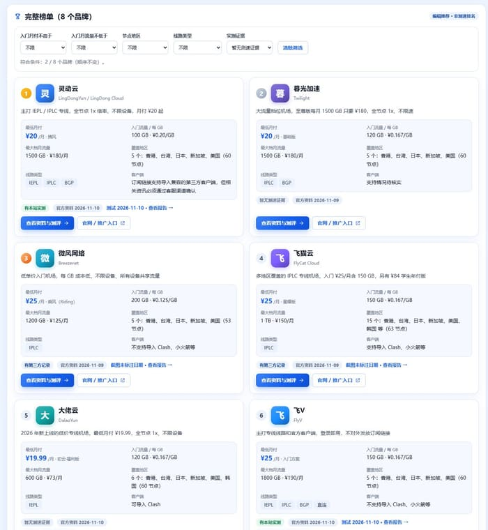 | 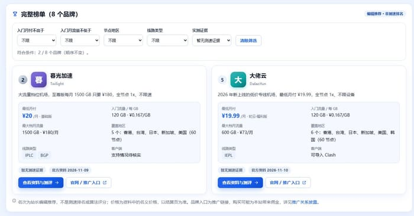 |
| 手机上的套餐表（375px） | 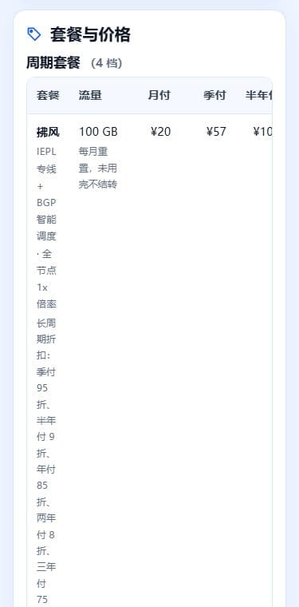 | 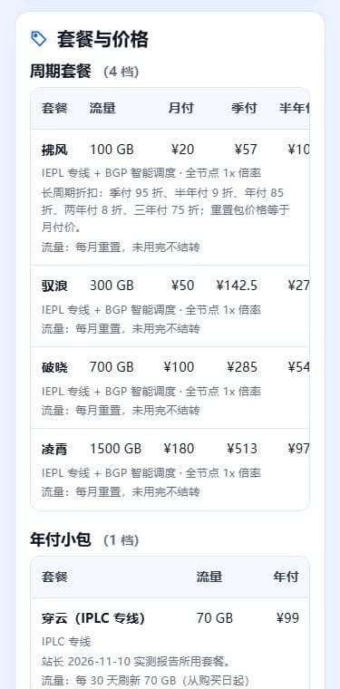 |
| 个人中心（375px）：卡片撑出屏幕 | 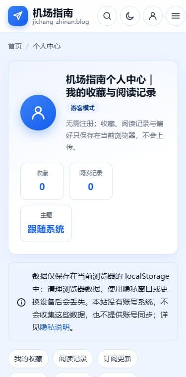 | 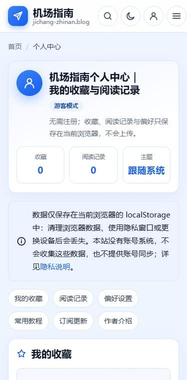 |
| 首页测速条形图（375px） | 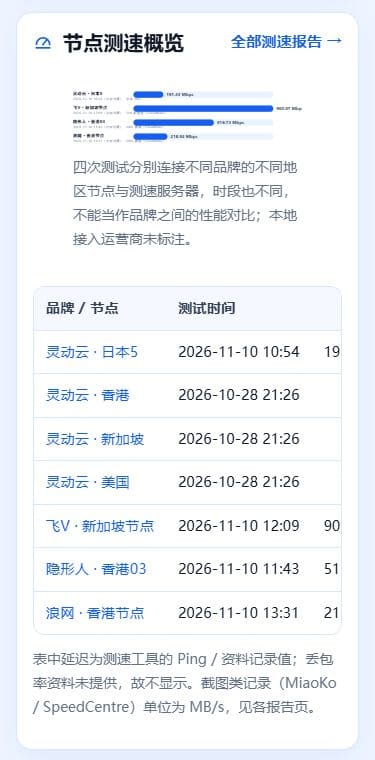 | 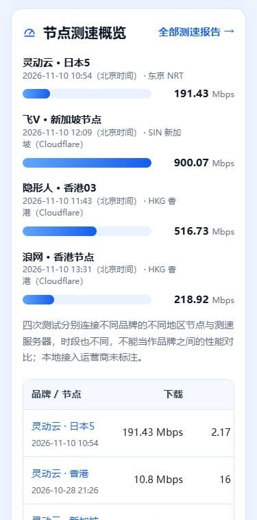 |
| 页头（320px）：菜单按钮被挤出屏幕 | 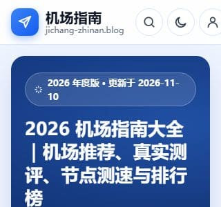 | 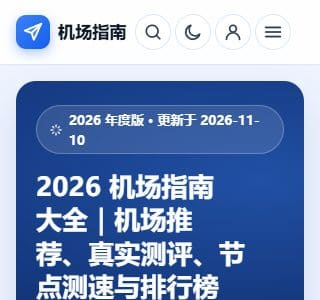 |
| 首页（768px）：两栏过窄 | 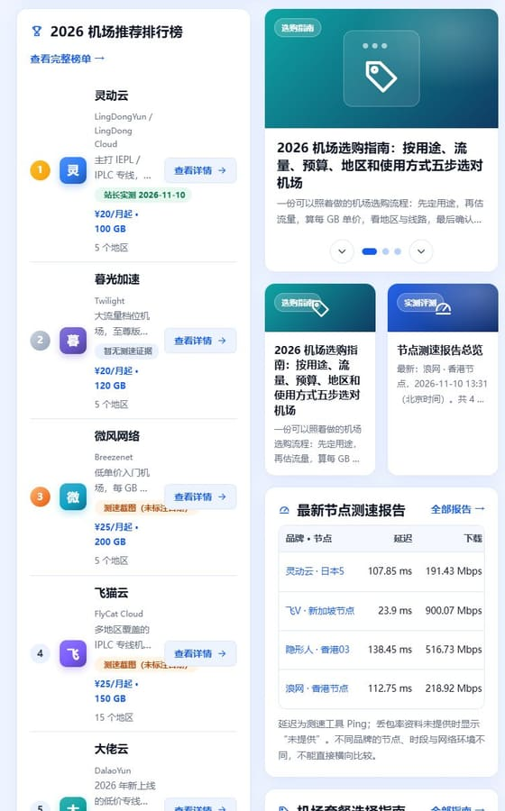 | 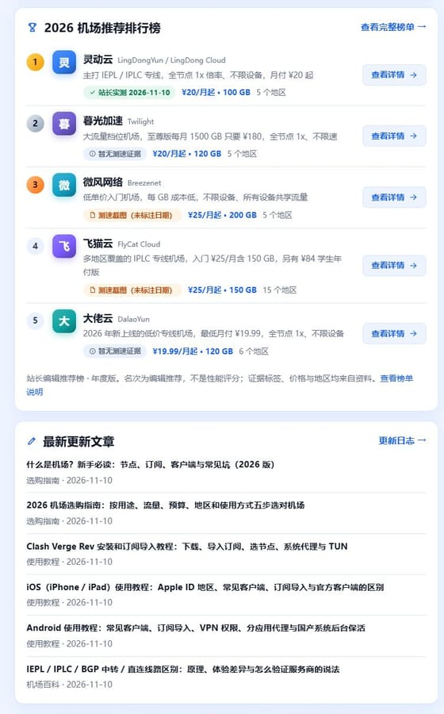 |
| 轮播箭头方向 | 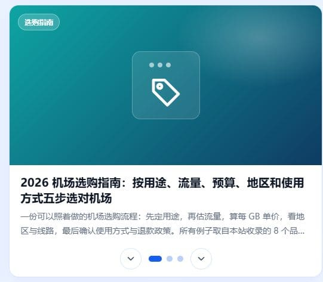 | 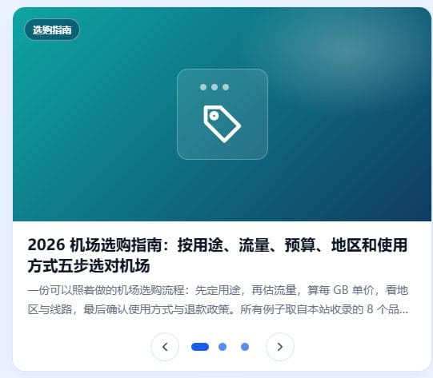 |
| 榜单分类页的专题榜排列（1440px） | 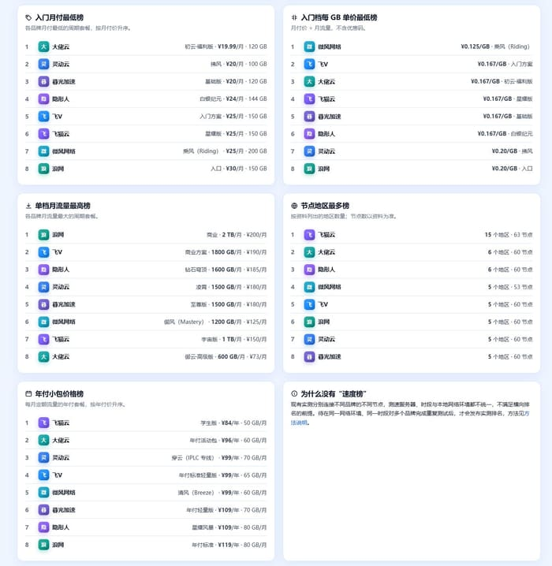 | 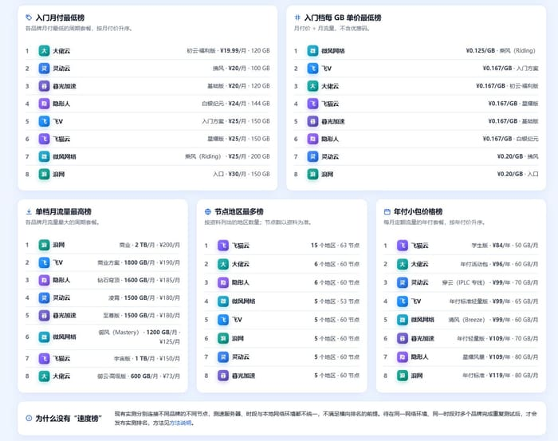 |
| 说明类页面（1440px） | 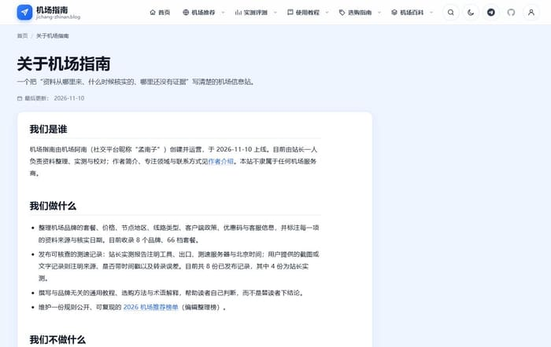 | 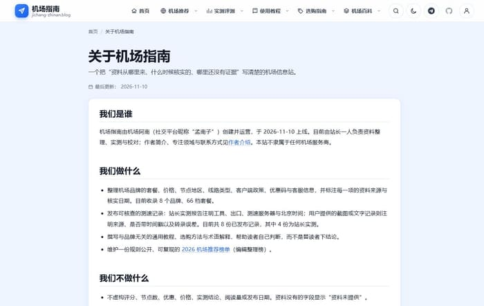 |
| 文章页（1440px） | 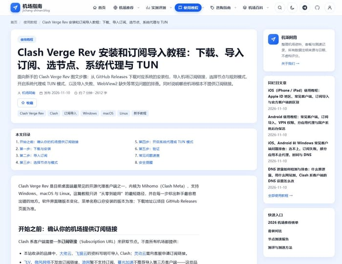 | 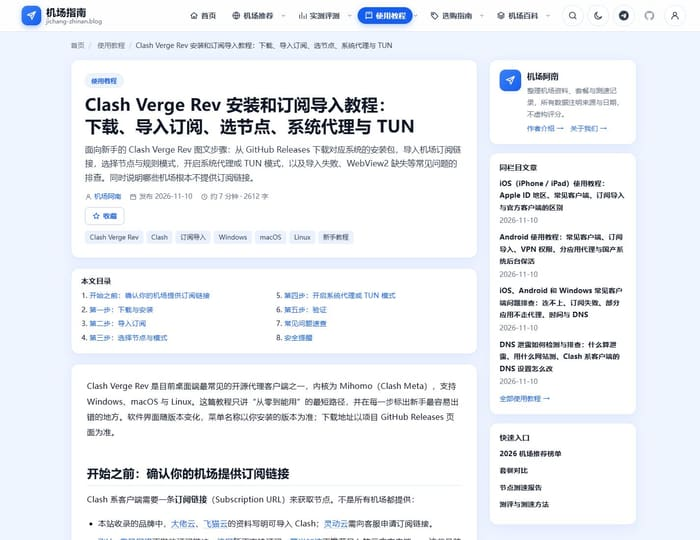 |
| 作者页（1440px） | 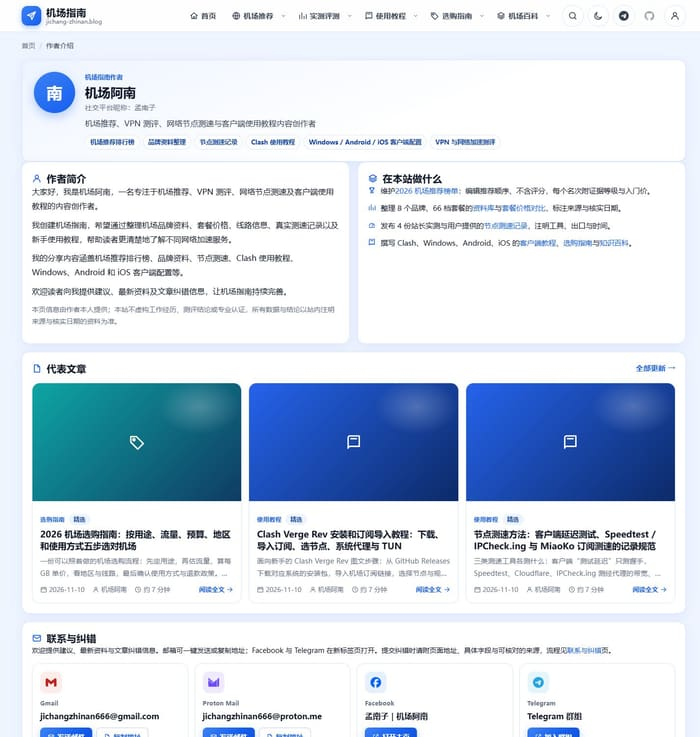 | 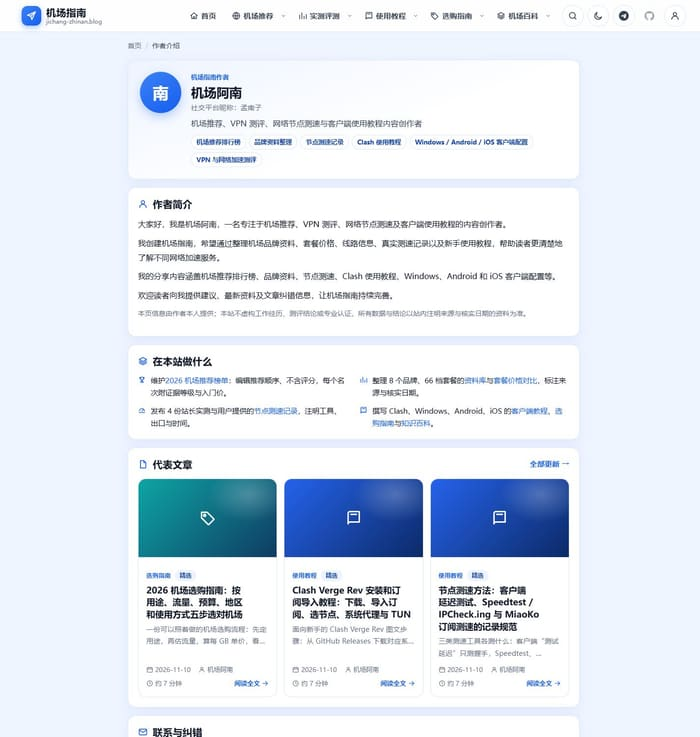 |
| 首页榜单：名次徽标对比度与行对齐 | 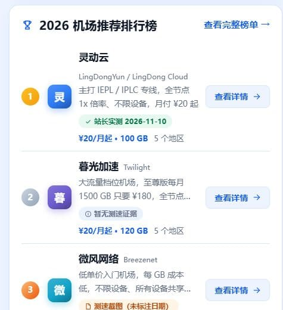 | 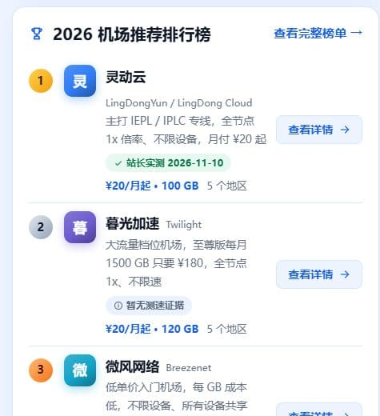 |
| 品牌资料卡片对齐（1024px） | 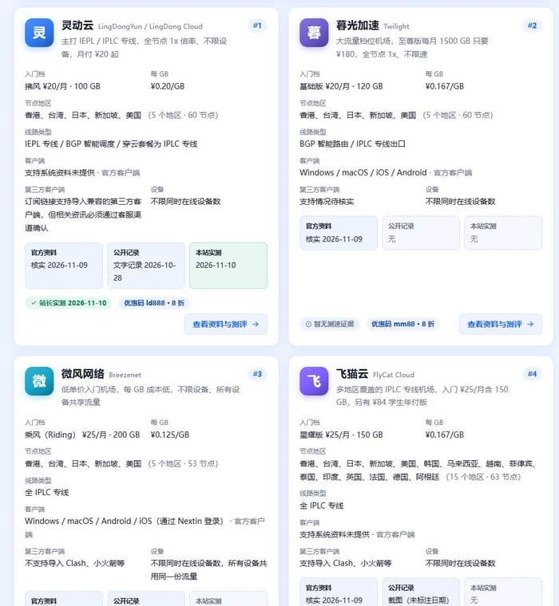 | 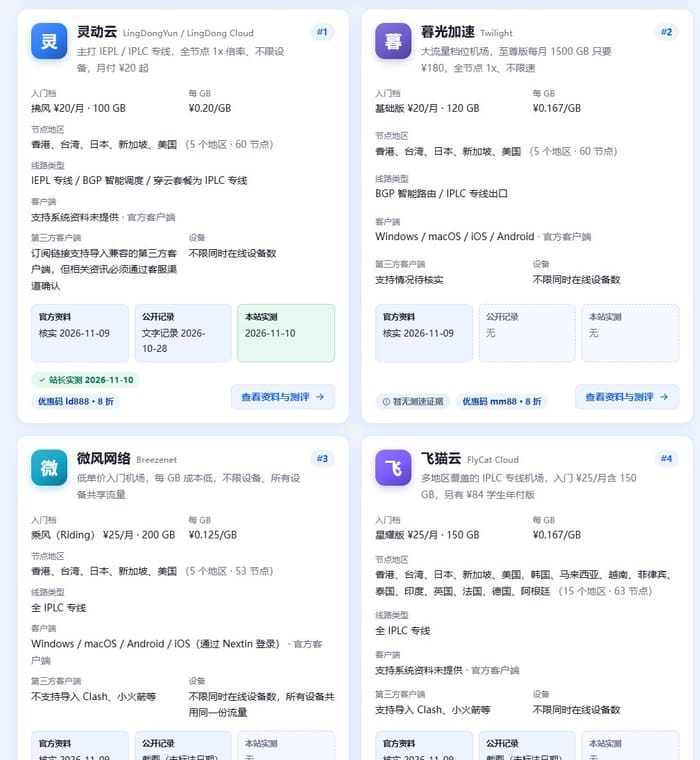 |
| 榜单速查表“线路”列（1024px） | 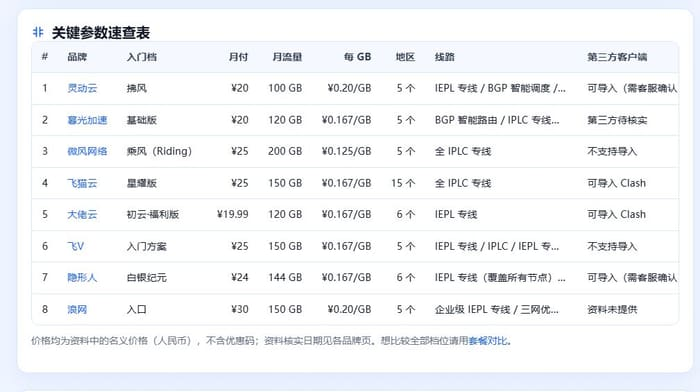 | 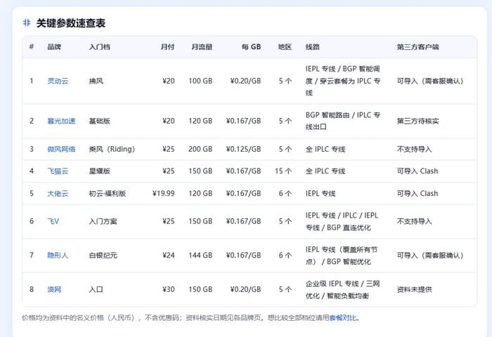 |

截图均为同一区域、同一宽度，“修复前”取自 `pre-ui-audit-20261110` 的构建，“修复后”取自当前构建。

---

## 5. 桌面、平板、移动端测试结果

### 5.1 布局扫描（浅色主题，每个宽度 52 页）

| 宽度 | 设备 | 修复前：有 P0 / P1 / P2 问题的页面数 | 修复前横向溢出 | 修复后：有 P0 / P1 / P2 问题的页面数 | 修复后横向溢出 |
| --- | --- | --- | --- | --- | --- |
| 320 | 小屏手机 | 52 / 32 / 52 | 52 页，最大 401px | 0 / 0 / 0 | 0 页 |
| 375 | 手机 | 1 / 31 / 52 | 1 页，346px | 0 / 0 / 0 | 0 页 |
| 390 | 手机 | 1 / 29 / 52 | 1 页，332px | 0 / 0 / 0 | 0 页 |
| 768 | 平板 | 0 / 15 / 8 | 0 页 | 0 / 0 / 0 | 0 页 |
| 1024 | 小型电脑 | 8 / 19 / 14 | 0 页 | 0 / 0 / 0 | 0 页 |
| 1440 | 桌面 | 0 / 18 / 24 | 0 页 | 0 / 0 / 0 | 0 页 |
| 1920 | 大屏 | 0 / 16 / 6 | 0 页 | 0 / 0 / 0 | 0 页 |

深色主题 7 个宽度的结果与浅色相同：P0 / P1 / P2 均为 0，没有对比度问题。

额外宽度 900、1280、1366：P0 / P1 为 0；剩 1 项 P2（见第 7 节第 4 条）。

布局跳动（CLS）：修复前最大 0.2234（个人中心），修复后 728 次渲染全部为 0。

### 5.2 交互实测（69 项全部通过）

| 分组 | 用例数 | 结果 |
| --- | --- | --- |
| 桌面页头导航：悬停与键盘展开下拉、Esc 关闭、六个一级入口跳转、站标回首页 | 6 | 通过 |
| 站内搜索：对话框开关、即时结果、回车进结果页、点击结果、中文关键词、无结果提示 | 5 | 通过 |
| 主题切换与个人中心菜单：刷新后保持、方向键、Esc、点击外部关闭 | 3 | 通过 |
| 首页：栏目标签、轮播箭头与圆点、Hero 按钮、侧栏搜索 | 6 | 通过 |
| 榜单页：按证据筛选、无结果空状态、清除筛选、折叠说明、推广入口属性 | 5 | 通过 |
| 品牌资料库：地区筛选、价格上限、排序、进入品牌页 | 4 | 通过 |
| 套餐对比：品牌勾选、流量下限、排序、页内锚点、每 GB 计算器 | 4 | 通过 |
| FAQ：展开、互斥收起、箭头翻转、键盘回车 | 2 | 通过 |
| 收藏、阅读记录与偏好：收藏、移除、清空记录、主题与字号、清除全部数据 | 7 | 通过 |
| 联系方式与外部链接：复制邮箱到剪贴板、mailto、社交链接属性、全站 182 个外链逐页核对 | 4 | 通过 |
| 文章页与品牌页：文章目录、上下篇、文中品牌、品牌页目录、8 个品牌页入口属性 | 5 | 通过 |
| 测速报告：8 份报告可进入、证据图加载且不变形、条形图有数据 | 3 | 通过 |
| 404、RSS、Sitemap、robots、跳到正文、Tab 顺序与焦点样式、减少动态效果 | 5 | 通过 |
| 手机 375px：汉堡菜单、子菜单、Esc、搜索与个人菜单不出屏、表格横向滚动、筛选、复制 | 8 | 通过 |
| 小屏 320px：页头四个按钮互不遮挡、个人中心不溢出 | 2 | 通过 |

---

## 6. 构建与自动化测试结果

| 检查 | 结果 |
| --- | --- |
| `npm run build`（数据校验 → 构建 → SEO 审计） | 通过。52 页；SEO 审计 0 错误、0 警告 |
| `npx astro check` | 0 错误、0 警告、1 条提示（复制邮箱的兼容写法，审计前就有） |
| `npm run ui:audit` 浅色 364 次渲染 | P0 / P1 / P2 为 0；横向溢出 0；CLS 0；控制台错误 0 |
| `npm run ui:audit -- --theme dark` 364 次渲染 | 同上 |
| `npm run ui:test` | 69 / 69 通过 |
| 应用内浏览器（Chrome 152）抽查 | 榜单筛选、首页栏目标签、轮播箭头方向正确，无控制台错误。窗口当时处于最小化，没能截图，所以**视觉结果只在无头 Chrome 157 里核对过** |

### SEO 没有被破坏的证据

把审计前的快照单独构建了一份，与当前构建逐页对比 52 个页面：

| 项目 | 有差异的页面数 |
| --- | --- |
| `<title>`、描述、canonical、robots、语言、OG、Twitter 标签 | 0 |
| H1 文字 | 0 |
| 结构化数据（JSON-LD） | 0 |
| 榜单品牌顺序 | 0 |
| 文章正文文字 | 0 |
| 站内链接集合（每页去重后的链接目标） | 0 |
| 图片说明文字 | 0 |
| `sitemap.xml`、`rss.xml`、`search-index.json` | 逐字节一致 |
| `robots.txt`、`_headers`、`_redirects` | 内容一致 |

有意的差异只有三处：

1. 飞V 与浪网品牌页上的官网链接补了 `sponsored`（地址未变）。
2. 8 个品牌页侧栏的小标题“相邻品牌”去掉了，链接本身移到正文末尾，一个没少。
3. 个人中心（不被收录）的区块顺序调整。

`src/data`、`src/content`、`src/lib/site.ts`、`src/lib/seo.ts`、`public/`、`source-materials/` 以及 Sitemap、RSS、IndexNow 相关脚本，相对回退点没有任何改动。

### 性能

本机无头浏览器测得，只能说明没有变差，不能代替线上数据。

| 指标 | 修复前 | 修复后 |
| --- | --- | --- |
| CLS 最大值 | 0.2234 | 0 |
| 页面体积中位数（未压缩） | 99 KB | 103 KB |
| 最重页面（未压缩） | 265 KB | 269 KB |
| 每页请求数 | 3–7 | 3–7 |

INP 需要真实用户数据，本次没有测。LCP 在本机只有几十到几百毫秒，没有参考价值。

---

## 7. 仍未解决的问题及原因

1. **13 项 P3：摘要文字的省略号截断。** 文章列表的两行摘要、测速报告卡片的三行摘要、首页轮播与小卡片的简介。这是摘要的常规做法，完整内容点进去就能看到，所以保留。品牌定位语、标题、价格、运营商名称这类数据已全部改为完整显示。
2. **套餐对比页的周期套餐表在手机上仍需横向滚动。** 首屏能看到品牌、套餐、月流量三列。这张表的行会被脚本排序和筛选，改成“说明另起一行”需要同时重写排序逻辑，风险与收益不成比例，本次没有动。
3. **首页“最新节点测速报告”小表在 320px 手机上还要横向滚动约 48px。** 375px 及以上不需要滚动。
4. **首页两张小卡片在 900 与 1280px 下高度差 67px。** 两张卡片标题一长一短造成，7 个必测宽度下不超过阈值。
5. **品牌标识仍是文字色块。** 没有收到官方 Logo，不能自己找图。
6. **只在 Chrome 内核里测过。** 没有测 Firefox 与 Safari，也没有用真机。用到的较新特性（子网格、容器查询、`:has()`、`text-wrap`）在不支持的浏览器里会退回到普通纵向排列或普通折行，不会错位，但这一点没有实测。
7. **手机上大标题仍可能把词拆开。** 每行只有十个字左右，只在标点处折行会让各行长短悬殊，所以手机上保持均衡折行，只保证「｜」不落行首、日期不被拆。

---

## 8. 需要你手动确认的事项

### 本次审计带来的（已于 2026-11-11 全部确认）

站长对下面 8 项的答复是“都认可”，全部按现状保留，不需要改回。具体到三项带有“请你定”的内容：第 1 项，年份文字保持不变，`package.json` 描述里的“2027”没有另外的指示，也保持不变（同日稍后站长要求年份用 2026，这处描述已改为 2026）；第 7 项，不写站内更新日志、不改页面更新日期；第 8 项，保留宽屏与窄屏两份排版。

1. **年份。** 任务标题写“2027”，站点是“2026 年度版”。没有改任何年份文字。`package.json` 的描述里还写着“2027 机场指南大全”，不影响页面，是否改成 2026 请你定。
2. **飞V、浪网的官网链接补了 `sponsored`。** 依据是项目规定“品牌入口均为推广链接”。如果这两个官网地址不算推广链接，告诉我改回去。
3. **品牌页“相邻品牌”小标题去掉了。** 改成正文末尾的“榜单上一位 / 返回全部品牌 / 榜单下一位”。
4. **首页品牌网格现在按编辑推荐顺序排列**，原先是数据文件里的顺序。
5. **文章页标题在桌面端由 40px 调为 34px。**
6. **按钮高度统一为 44px 与 36px**，原先是 48、41、38px 混用。
7. **没有写入站内“更新日志”，也没有改任何页面的更新日期。** 这次只动了界面，内容没变。如果你希望在更新日志里记一笔，告诉我措辞。
8. **三处内容在 HTML 里各有两份排版。** 品牌页的套餐说明、首页测速小表的出口运营商、首页测速概览的测试时间：宽屏与窄屏各有一份标记，任何时候只显示其中一份，文字完全相同。这是响应式表格的常见做法。如果你担心搜索引擎把它看成隐藏文字，告诉我，可以改成只保留一份，代价是桌面端的说明也会改成显示在每行下方。

### 之前遗留、仍在等你答复的

1. GitHub 主页链接。
2. 微风网络“清风”套餐价格：数据里是 ¥99，你提供的介绍文案里是 ¥137。
3. 三个品牌介绍文案与原始资料不一致的说法：暮光加速的“IEPL”与多客户端兼容、隐形人的“IPLC”、浪网的 BGP / 独立 IP / 1 倍率 / 多平台。
4. 测速报告页的报告卡片是否也按编辑推荐顺序排列。
5. 导航“实测评测”是否应指向测速报告页。
6. 部署与推送的批准、Bing / Google 验证值、IndexNow Key、官方 Logo、大佬云与暮光加速的实测。
